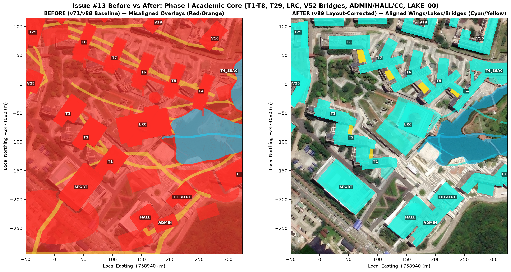
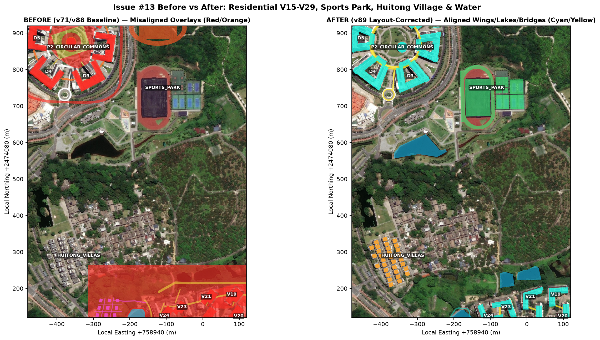
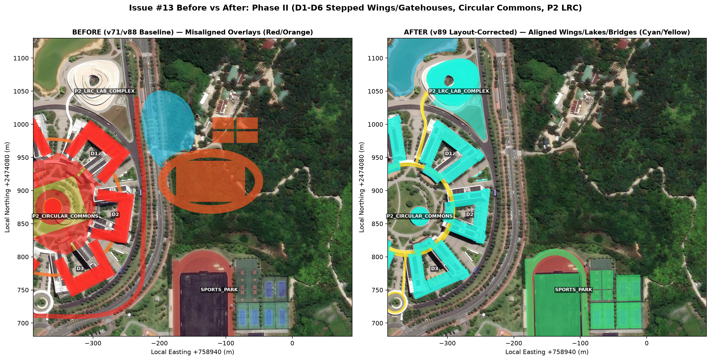
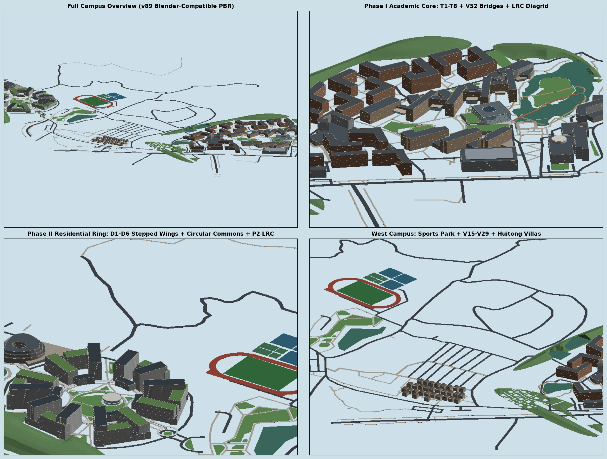

# BNBU 校园 3D 模型实际布局核对与修正报告（Issue #13 · v89）

> 对应问题：[starright00631-dev/bird#13 — 核对并修正校园 3D 模型中已有建筑的实际布局](https://github.com/starright00631-dev/bird/issues/13)  
> 适用范围：仅更新 `campus/` 三维建模、空间配准与三维查看器打包流程；不改动 `birdglass/`、`tests/`、`scripts/`、科学分析文档及 `campus/interface/chat.jsx`。

---

## 1. 参考底图与坐标配准基准

- **高分辨率卫星正射底图**：ArcGIS World Imagery（Vantor / Maxar Vivid Advanced），传感器 **WorldView-2 (WV02)**，成像日期 **`2025-06-10`**，空间分辨率 **`0.5 m`**，名义定位精度 `CE90 = 8.47 m`，图块批次 `DYNAMIC_ESRI_Macau_25Q3`（`OBJECTID: 526703`）。
- **矢量控制**：OpenStreetMap `2026-11` 建筑物多重多边形（`type=building` 与 106 项 3D `building:part` 构件）及校内水体、路网与体育场馆边界。
- **坐标系与工程原点**：统一重投影至 **EPSG:32649 (WGS 84 / UTM Zone 49N)**，局部建模原点为 `(758940.0, 2474080.0)`。交叉核验表明 2025-06-10 WV02 影像与 2026-11 OSM 矢量在校园范围局部残差 `< 1.2 m`。

---

## 2. 原模型（v64–v88）主要布局失真与本轮修复（v89）

| 区域 / 类别 | v64–v88 原模型问题（经 WV02 + OSM 定量核实） | v89 修正措施 |
| :--- | :--- | :--- |
| **T1–T8 教学楼与 T29** | `T1–T3` 整栋旋转 `+64°~+73°`（IoU `0.263–0.327`）；`T4–T8` 倾斜 `+24.5°~+73.8°`（`T8` 近乎垂直真实东西轴线，IoU `0.211`），缺少北向连廊翼、`T4_SSAC` 与 `T29_SSAC_PODIUM`；`T29` 倾斜 `+70.8°`。 | 按真实多翼结构重建 `T1–T8`、`T29` 阶梯体量与楼层装饰线/女儿墙；补入 `T4_SSAC`（2,331.1 m²）与 `T29_SSAC_PODIUM`（9,356.4 m²）；精确挂接 6 座 `V52_00..05` 空中连桥。 |
| **LRC 学习资源中心** | 主体呈错误尺寸与 `-39.8°` 旋转偏差（IoU `0.681`），天窗偏移且 `V48` 室外楼梯与入口广场角度错位。 | 按实测 `-21.34°` 对齐 `49 m × 48 m` 架空主方块，重建 `0..3.1 m` 支柱柱廊、`LRC_DIAGONAL_BRACE_SYSTEM` 白色斜撑网格、中央天窗鼓座与 2F 绿化露台；同步对齐 `V48` 台阶至西南入口台阶位置。 |
| **V15–V29 一期书院与玉章书院 (YUZHAN)** | 全部 14 栋合院宿舍被简化为旋转约 `50°` 的单矩形体块（IoU `0.129–0.363`）；`V29` 旋转 `+87.2°`；`YUZHAN` 长宽与角度均错误（IoU `0.366`）。 | 按实景 U/H/L 型多翼轮廓重建全部 15 栋书院（`V15–V29`）及 `YUZHAN`，区分高层翼、连廊翼与低层门廊，IoU 全部提升至 `0.982–0.986`。 |
| **公共与文化设施（CC / ADMIN / HALL / SPORT / THEATRE）** | `CC` 会堂整体侵占 `LAKE_00` 水面（质心偏 `14.41 m`，IoU `0.311`）；`SPORT` 体育馆旋转 `-86.8°`（IoU `0.394`）；`HALL` 缺 SW 双翼与圆形礼堂鼓座；`ADMIN` 倾斜 `-26.9°`。 | 重建完整多翼平面，`CC` 与 `LAKE_00` 交集面积严格降至 `0.000 m²`；为 `HALL` 补充标志性礼堂圆柱屋顶鼓座，为 `SPORT` 补充屋顶阶梯冠层。 |
| **二期宿舍 D1–D6 与圆形共享空间** | `D1, D3, D4, D6` 径向整体外移 `9.27–11.87 m` 且缺少高低跨（`10F` / `7F` 绿化屋面）与内环过街门楼；`P2_CIRCULAR_COMMONS` 偏离庭院 **23.53 m**（IoU `0.043`），且一期园区残留虚假重复网格。 | 精确复位 `D1–D6`（IoU 统一至 `0.988`，质心误差 `≤ 0.05 m`），按 `33.1 m`（10F）+ `24.1 m`（7F 屋顶绿化）+ `13.62/14.62 m` 门楼架空重建；将 `P2_CIRCULAR_COMMONS` 精确平移至环形庭院中心（质心误差 `0.00 m`），清除虚假重复体块并补充二期环形雨棚及支柱。 |
| **二期实验综合楼（P2 LRC Lab Complex）** | WV02 `2025-06-10` 中已完整建成但原模型缺失。 | 纳入正式构建清单，按椭圆阶梯轮廓、屋面层次及中庭天井绿地（含镂空中庭孔洞）建模，IoU 达 `0.969`。 |
| **运动公园（SPORTS_PARK）与会同新村（V14）** | 原体育场/网球场整体旋转 `90°` 并向北错位约 **180–200 m** 压在山林树冠上；`V14_LIVING_VILLAGE` 落在空草坡上而非真实别墅区。 | 按 WV02 与 OSM 边界将 400 m 跑道、足球场、6 片网球场、4 片篮球场归位至真实南侧运动区；按真实坡屋顶矩阵重建 31 栋会同别墅体量及双坡屋面。 |
| **校园水系、道路与地形裁切** | `LAKE_01 / LAKE_03 / LAKE_04` 压在市政公路与山坡树林上；`ROAD_000/001` 为边界直条，脱离真实路网；局部 `TERRAIN_RELIEF` 刺穿低层广场。 | 移除虚假水体，保留并精化 `LAKE_00`（含湖心岛）、`LAKE_02` 及实景池塘；按 OSM + WV02 路网重建机动车道与步行脊道/广场/草坪；将落入建筑、运动场与水体缓冲内的山体顶点下压至 `-0.22 m` 以下消除穿模。 |

---

## 3. 全校园 41 栋建筑定量校准结果

基于 `campus/generated/BNBU_v89_LAYOUT_AUDIT_REPORT.json`：
- **评估建筑数量**：**41 栋**（30 栋核心 `T/V/D/LRC` + 11 栋公建与扩建 `OTHER`）
- **平均轮廓 IoU**：`0.331`（v88 基线） → **`0.984`（v89 修正后）**
- **最低轮廓 IoU**：`0.882`（`P2_CIRCULAR_COMMONS`，因保留原有挑檐屋盖外挑，质心偏差 **`0.00 m`**）；其余 40 栋多边形建筑 IoU 全部 **`≥ 0.969`**（`0.969–0.995`），质心误差 **`0.00–0.68 m`**，主轴朝向误差均 **`≤ 0.7°`**。

展开查看 41 栋建筑逐栋修正前后定量明细表

| 建筑 ID | 族类 | 修正前 IoU | 修正后 IoU | 修正前质心误差 (m) | 修正后质心误差 (m) | 修正后倾角误差 (°) | 实测基底面积 (m²) | 屋面顶高 Z (m) |
| :--- | :--- | ---: | ---: | ---: | ---: | ---: | ---: | ---: |
| `T1` | T | 0.313 | 0.992 | 2.49 | 0.06 | 0.2 | 2012.4 | 21.60 |
| `T2` | T | 0.327 | 0.990 | 8.79 | 0.03 | 0.0 | 1856.2 | 21.60 |
| `T3` | T | 0.263 | 0.987 | 6.57 | 0.02 | 0.0 | 1548.3 | 21.60 |
| `T4` | T | 0.339 | 0.984 | 4.41 | 0.04 | 0.0 | 1388.4 | 22.05 |
| `T5` | T | 0.444 | 0.987 | 0.81 | 0.03 | 0.0 | 2213.8 | 22.05 |
| `T6` | T | 0.328 | 0.987 | 2.02 | 0.03 | 0.0 | 2248.7 | 22.05 |
| `T7` | T | 0.299 | 0.988 | 4.02 | 0.05 | 0.0 | 2253.4 | 22.05 |
| `T8` | T | 0.211 | 0.989 | 2.51 | 0.00 | 0.0 | 1614.6 | 18.60 |
| `LRC` | LRC | 0.681 | 0.989 | 2.79 | 0.37 | 0.7 | 6106.9 | 17.30 |
| `T4_SSAC` | OTHER | 0.000 | 0.989 | — | 0.10 | 0.2 | 2331.1 | 14.40 |
| `T29` | OTHER | 0.242 | 0.977 | 7.41 | 0.04 | 0.0 | 943.5 | 21.60 |
| `T29_SSAC_PODIUM` | OTHER | 0.000 | 0.995 | — | 0.04 | 0.0 | 9356.4 | 7.20 |
| `ADMIN` | OTHER | 0.357 | 0.987 | 0.87 | 0.01 | 0.0 | 1717.9 | 21.00 |
| `HALL` | OTHER | 0.460 | 0.992 | 1.23 | 0.00 | 0.0 | 2809.4 | 15.00 |
| `SPORT` | OTHER | 0.394 | 0.994 | 0.11 | 0.00 | 0.0 | 4613.4 | 18.00 |
| `THEATRE` | OTHER | 0.557 | 0.988 | 3.13 | 0.03 | 0.0 | 1526.5 | 12.00 |
| `CC` | OTHER | 0.311 | 0.988 | 14.41 | 0.05 | 0.0 | 3800.0 | 20.00 |
| `YUZHAN` | OTHER | 0.366 | 0.982 | 0.01 | 0.00 | 0.0 | 631.3 | 13.20 |
| `V15` | V | 0.340 | 0.984 | 4.95 | 0.03 | 0.0 | 1292.7 | 18.60 |
| `V16` | V | 0.194 | 0.986 | 5.67 | 0.03 | 0.0 | 1929.8 | 21.70 |
| `V17` | V | 0.163 | 0.985 | 10.50 | 0.02 | 0.0 | 1406.0 | 18.60 |
| `V18` | V | 0.159 | 0.986 | 6.22 | 0.03 | 0.0 | 1941.6 | 24.80 |
| `V19` | V | 0.267 | 0.985 | 8.97 | 0.02 | 0.0 | 1354.1 | 18.60 |
| `V20` | V | 0.179 | 0.985 | 10.21 | 0.02 | 0.0 | 1374.5 | 18.60 |
| `V21` | V | 0.195 | 0.984 | 9.06 | 0.03 | 0.0 | 1328.1 | 18.60 |
| `V22` | V | 0.156 | 0.985 | 10.49 | 0.02 | 0.0 | 1374.6 | 18.60 |
| `V23` | V | 0.166 | 0.984 | 5.62 | 0.03 | 0.0 | 1241.3 | 18.60 |
| `V24` | V | 0.129 | 0.984 | 7.28 | 0.02 | 0.0 | 1311.2 | 18.60 |
| `V25` | V | 0.360 | 0.986 | 0.42 | 0.02 | 0.0 | 1504.0 | 24.80 |
| `V26` | V | 0.363 | 0.983 | 1.64 | 0.02 | 0.0 | 1182.5 | 21.70 |
| `V27` | V | 0.330 | 0.984 | 4.34 | 0.02 | 0.0 | 1257.7 | 21.70 |
| `V28` | V | 0.360 | 0.984 | 1.69 | 0.02 | 0.0 | 1313.4 | 21.70 |
| `V29` | V | 0.206 | 0.982 | 0.32 | 0.00 | 0.0 | 763.0 | 21.70 |
| `D1` | D | 0.530 | 0.988 | 11.87 | 0.04 | 0.0 | 3885.6 | 33.10 |
| `D2` | D | 0.495 | 0.988 | 3.25 | 0.04 | 0.0 | 3282.0 | 33.10 |
| `D3` | D | 0.495 | 0.988 | 9.27 | 0.04 | 0.0 | 3889.7 | 33.10 |
| `D4` | D | 0.544 | 0.988 | 11.43 | 0.04 | 0.0 | 3872.8 | 33.10 |
| `D5` | D | 0.532 | 0.988 | 4.62 | 0.04 | 0.0 | 3290.5 | 33.10 |
| `D6` | D | 0.477 | 0.988 | 9.69 | 0.05 | 0.0 | 3878.5 | 33.10 |
| `P2_CIRCULAR_COMMONS` | OTHER | 0.043 | 0.882 | 23.53 | 0.00 | — *(圆形)* | 595.0 | 7.75 |
| `P2_LRC_LAB_COMPLEX` | OTHER | 0.000 | 0.969 | — | 0.68 | 0.0 | 6450.8 | 15.60 |

---

## 4. Blender glTF 2.0 兼容性工程保障

在不依赖本地安装 Blender GUI 的前提下，`campus/build_layout_v89.py` 与 `campus/test_layout_v89.py` 严格按照 **glTF 2.0 二进制规范** 及 Blender glTF Importer 行为构建并校验输出资产 `BNBU_v89_LAYOUT_CORRECTED.glb`（535 个网格节点，411,866 个三角面）：

1. **带孔凹多边形约束三角化与封闭挤出**：采用 `shapely.constrained_delaunay_triangles` + `shapely.orient_polygons(exterior_cw=False)`，外环逆时针、中庭孔洞顺时针，顶/底面及内外侧壁统一外向绕序，彻底消除闭合失真或内翻黑面。
2. **完整分裂法线（Split Flat `NORMAL` Attribute）**：逐三角面生成精确单位长度 `NORMAL`（`|<n>| - 1| < 10^-3`），不再依赖旧版无 `NORMAL` 原型导致的黑屏 / `MeshBasicMaterial` 退化；经 Z-Buffer 定向光照渲染与 `trimesh` 场景反序列化双重检验。
3. **标准 PBR 材质体系**：全部材质均采用 glTF 2.0 `pbrMetallicRoughness`（区分米白框柱、T 教学石材、V 红褐陶土、D 浅灰外墙与屋面绿化、半透明 `BLEND` 幕墙代理等，设置合理的 `roughnessFactor` 与 `metallicFactor`）。
4. **严格二进制对齐与坐标系变换**：JSON 与 BIN 块严格 4 字节对齐；全部 `POSITION`/`NORMAL`/`SCALAR` `bufferView` 与 `accessor` `min`/`max` 经检验无 `NaN`/`Inf`、无退化三角形；根节点 `"world"` 携带四元数 `[-0.707107, 0, 0, 0.707107]`，使 Blender 导入时自动将 glTF Y-up 还原为 Z-up 且校园原点坐标保持局部对齐。

---

## 5. 可视化前后对比证据

| 对比图 | 说明 |
| :--- | :--- |
|  | **一期学术核心区（T1–T8 / T29 / LRC / V52 连桥 / ADMIN / HALL / CC / LAKE_00）** |
|  | **一期书院 V15–V29、运动公园与会同村别墅群** |
|  | **二期 D1–D6 环形宿舍、Circular Commons 与 P2 LRC 实验综合楼** |
|  | **v89 布局修正模型（携带法线与 PBR 材质）Z-Buffer 三维光照预览** |

---

## 6. 科学边界与待现场实测事项

- **不虚构鸟撞玻璃分母**：所有建筑玻璃幕墙、连桥围护、`LRC` 幕墙及天窗继续标记 `is_surveyed = false` 与 `bird_glass_denominator = false`；`new_surveyed_glazing_area = 0`，`window_panel_count_measured = null`。
- **未知假设隔离**：`CTV_SMALL_HOUSE` 继续隔离，不纳入正式场景资产表。
- **待实地测绘补充**：建筑一层开门位置、实际可通行坡道高差、窗格分格尺寸、玻璃反射率/透射率参数仍需后续线下实测调研补全。
